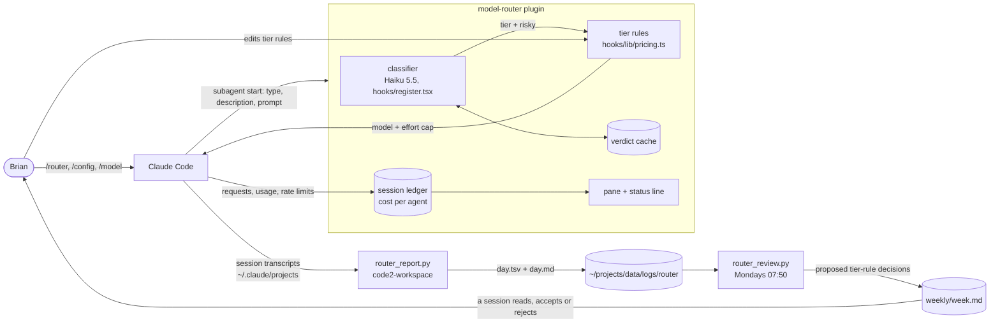

# model-router system model

Source for every line: the file named beside it, read at the revision this package describes.

## What it is

A Claude Code plugin (a "mod", TypeScript, run by Claude Code's plugin engine) that sits on the subagent-start hook. For each subagent it picks a model and a reasoning-effort cap, shows the cost in a pane, and moves a stuck agent up a model. It does not touch the main conversation (README.md "Limits"; research-routing-best-practices.md section 1.4).

## Context view: what is inside and what talks to it

## What it stores, changes, records and shows

| Thing | Where | Kept |
| --- | --- | --- |
| Mode (`on`, `off`, `haiku`, `sonnet`, `opus`) | engine storage via `storedMode` (hooks/register.tsx:423) | across sessions |
| Verdict cache (task key to tier and risky flag) | engine storage via `rememberClass` (hooks/register.tsx:512) | across sessions |
| Learned model per agent type | `rememberTypeModel` (hooks/register.tsx:452) | across sessions |
| Ledger of agents, tokens, cost | engine ledger summed by `totals` (hooks/register.tsx:117), shown in the pane | the session; `/router reset` clears |
| Daily report, one row per run with `tier` and `outcome` | `~/projects/data/logs/router/<day>.tsv`, `.md` (written by `scripts/router_report.py` in code2-workspace) | append per day |
| Weekly review with proposed decisions | `~/projects/data/logs/router/weekly/<week>.md` (`scripts/router_review.py`) | one file per week |

## What it changes

At subagent start it rewrites the agent's model, and caps its effort at the tier's cap (hooks/register.tsx:820). Order of rules, from the task to the final tier: classifier verdict, role limits (`ROLE_LIMITS`, hooks/lib/pricing.ts:180), judging-agent floor (hooks/lib/pricing.ts:196), risk floor, then the cheaper-tier pressures (rate limit, pace, budget), each held above `PRESSURE_FLOOR` (hooks/lib/pricing.ts:245). Mid-run it can rescue a stuck agent one model up (hooks/register.tsx:264).

## Tier and effort table (this package's subject)

| Tier | Model | Effort cap | Basis |
| --- | --- | --- | --- |
| easy (`simple`) | Haiku 5.5 | low; medium when the prompt is over 200,000 characters (about 50k tokens) | hooks/lib/pricing.ts:53-70 |
| normal (`standard`) | Sonnet 5.5 | medium | hooks/lib/pricing.ts:53 |
| hard | Opus 5.5 | high | hooks/lib/pricing.ts:53 |
| long | Fable 5.1 | unchanged | hooks/lib/pricing.ts:53 |

## Does it execute typed rules?

No. The tier rules are an ordered function over a tier, a role and four flags (`routeTier`, hooks/lib/pricing.ts:247), not relations with named roles whose effects run.

## Failure and trace visibility

A routed agent's why-line (pane, `ctrl+x tab`) states the tier, the rule that moved it and the effort cap. The daily `.tsv` has one row per run with the transcript path, so any outcome can be traced to the full subagent transcript under `~/.claude/projects/<project>/<session>/subagents/`. The weekly review lists the transcript paths of the bad runs to read before any decision is accepted.
